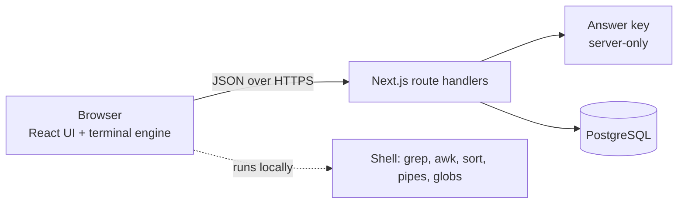

# Blackout · a cyber escape room

Players learn to investigate like a SOC analyst, one small step at a time, and then solve a live incident against the clock. No prior knowledge needed.

Six stages, each a different topic, from easiest to hardest. Each stage has three guided tasks (a plain-language lesson, then a practice exercise) and a final incident solved alone against the clock:

| Stage | Topic | What players learn |
|---|---|---|
| 1 | Logs | Reading a log, `grep`, counting with pipes, brute force vs password spraying |
| 2 | Phishing | Email headers (Reply-To, SPF, DKIM), real vs displayed links, lookalike domains, proxy logs |
| 3 | Threat intelligence | IP reputation (`iprep`), WHOIS domain age (`whois`), scanning a site safely (`urlscan`) |
| 4 | A suspicious file | Double extensions, hashes and VirusTotal-style verdicts (`vt`), sandbox reports, persistence |
| 5 | Web attacks | Web server logs, status codes, SQL injection, URL encoding (`urldecode`), spotting a successful dump |
| 6 | Ransomware | DNS logs, beaconing, data exfiltration in netflow, stopping encryption on a file server |

Accessibility comes first: every task opens with a one-sentence summary, every command has a tooltip and a live explanation while typing, the dictionary explains commands and terms, stuck players get a tip and then the exact command, and a "large text" switch enlarges the whole interface. Every task ends with stars and a certificate sized for a LinkedIn post or a story; finishing all six earns the SOC analyst certificate. A live leaderboard ranks players, and an admin dashboard shows where people get stuck.

## Architecture



| Layer | What it does |
|---|---|
| `src/lib/game/shell.ts` | A pure, tested terminal: pipes, quotes, globs, `grep -c -v -l -i -n -E`, `awk`, `cut`, `sort`, `uniq -c`, `wc -l`, plus intel tools `iprep`, `whois`, `urlscan`, `vt`, `sandbox`, `urldecode` |
| `src/lib/game/intel.ts` | A fictional threat-intelligence database behind the intel tools |
| `src/lib/game/evidence.ts` | Case files generated deterministically, so browser and server see the same evidence |
| `src/lib/server/answers.ts` | The answer key, hints and decoy feedback. Marked `server-only`, so it can never ship to the browser |
| `src/lib/server/game.ts` | Game rules and SQL: unlocking, attempts, scoring, the incident clock, leaderboard, analytics |
| `src/app/api/*` | Thin route handlers: validation with Zod, auth, rate limits |
| `src/components/*` | Level map, lessons, terminal with command tooltips, dictionary, certificates, admin dashboard |

## Security decisions

- **The server owns the truth.** Answers are checked on the server, and the client never receives the key. The incident timer is a deadline stored in the database: wrong answers and hints move it, and a late answer is rejected even if the browser clock is changed.
- **Ownership checks.** A player can only answer their own attempts, and later levels stay locked server-side until the previous one is complete.
- **Credentials.** 4-digit PINs are hashed with scrypt and a per-player salt. Sessions are HMAC-signed, HttpOnly, SameSite cookies. Admin access uses a separate short-lived signed cookie and constant-time password comparison.
- **Abuse limits.** Rate limits on sign-in, admin login and answer submission. All input is validated with Zod; nicknames are restricted to letters, digits and a few symbols.
- **Headers.** A strict Content-Security-Policy, `frame-ancestors 'none'`, `nosniff` and a referrer policy.
- **Data minimisation.** Only a nickname, the hashed PIN and game results are stored.

## Data model

`players` (nickname, hashed PIN, last seen) → `attempts` (one row per level run: start, deadline, wrong answers, hints, stars, duration) → `answers` (every submission, which powers the "where people get stuck" view). The leaderboard and analytics are plain SQL with `DISTINCT ON`, `FILTER` and window functions.

## Run locally

```bash
npm install
npm run dev
```

No database setup is needed: without `DATABASE_URL` the app uses [PGlite](https://pglite.dev), a real Postgres compiled to WebAssembly, stored in `.data/`. Set `ADMIN_PASSWORD` in `.env.local` to open `/admin`.

With Docker and a real Postgres:

```bash
SESSION_SECRET=$(openssl rand -hex 32) ADMIN_PASSWORD=choose-one docker compose up --build
```

## Tests

```bash
npm test        # terminal engine + full API flows against an in-memory Postgres
npm run typecheck
```

Tests prove every practice task is solvable from its own evidence and every incident from its case files. The API tests register players, play all 24 tasks to the end, check that locked levels stay locked, that one player cannot answer another's run, that the server-side clock applies penalties and the hidden-file bonus once, and that the admin view is protected.

## Deploy

1. Import the repository into [Vercel](https://vercel.com).
2. In the project, open **Storage** and connect a free Neon Postgres database. Vercel sets `DATABASE_URL` for you.
3. Optionally set `ADMIN_PASSWORD` (for `/admin`) and `SESSION_SECRET` (`openssl rand -hex 32`). Without `SESSION_SECRET`, sessions are signed with a key derived from `DATABASE_URL`.
4. Redeploy. Tables are created on the first request.

The rate limiter is in memory, which suits a single instance. For several instances, move it to Redis.

## Roadmap

- [x] Six stages: logs, phishing, threat intel, malware, web attacks, ransomware
- [x] Server-checked answers, server-side clock, leaderboard, admin analytics
- [ ] English version
- [ ] Achievements and a speedrun mode
